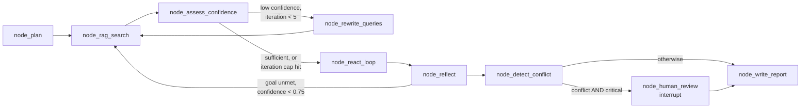

# Financial Research Agent

A LangGraph agentic RAG system that answers analyst-style questions over **SEC 10-K filings** (Apple, Microsoft, Amazon, FY2025). It plans its research, scores its own confidence, retries with rewritten queries, calls external tools when the filings fall short, **detects conflicting figures across sources**, and **pauses for human review** when a conflict actually matters.

> **Why this exists:** Comparing companies on their own filings takes an analyst hours. The data is spread across hundreds of pages, fiscal years don't line up, and sources can disagree. A plain LLM won't tell you when they do. This agent is built to notice and to escalate.

---

## How it works

### The 9 nodes

| # | Node | What it does |
|---|---|---|
| 1 | `node_plan` | Breaks the question into research goals (Bedrock Claude Haiku 4.5, JSON output with safe-parse) |
| 2 | `node_rag_search` | Retrieves evidence via the RAG API (Cohere Embed v4 → OpenSearch → Cohere Rerank 3.5); full question on first pass, rewritten variant on retry |
| 3 | `node_assess_confidence` | LLM-as-judge scores relevance and coverage (0.0–1.0). **Confidence ≠ correctness**: fact-checking happens later |
| 4 | `node_rewrite_queries` | Generates 5 paraphrased query variants on a low-confidence retry |
| 5 | `node_react_loop` | Hand-rolled ReAct loop: the LLM picks only the tools needed to close evidence gaps |
| 6 | `node_reflect` | Checks each research goal against all evidence gathered so far |
| 7 | `node_detect_conflict` | Two-layer conflict check: LLM reasoning plus a deterministic `_verify_cited_figures` veto |
| 8 | `node_human_review` | `interrupt()` pauses the graph, state is checkpointed to DynamoDB, and the run resumes via API |
| 9 | `node_write_report` | Writes the final report from the **best** evidence seen across all retries, not just the last attempt |

### Routing decisions

- **`route_after_confidence`:** the iteration cap (5) is checked *first*, as a circuit breaker. Otherwise a low score triggers a retry with rewritten queries.
- **`route_after_reflection`:** an unmet goal goes to tools only if `confidence_score >= 0.75`. Below that, it does another RAG retry instead of spending a tool call.

The two thresholds are separate on purpose. One controls how many RAG retries happen, and the other controls when current evidence is trusted enough to spend a tool call.

### Tools (allowlisted, LLM-selected)

| Tool | Source | Purpose |
|---|---|---|
| `get_stock_price` | yfinance | Current price, 52-week range |
| `get_financial_ratios` | yfinance | P/E, P/B, ROE (flagged for period mismatch) |
| `get_earnings_history` | yfinance | Last 4 quarters |
| `get_company_news` | yfinance | Recent headlines |
| `get_competitor_comparison` | yfinance | Peer comparison |
| `search_web` | Tavily | Fallback when RAG evidence is thin; prompted to stay within the in-scope fiscal years |
| `check_data_completeness` | internal | Confirms that retrieved chunks actually cover the goal |

Unknown tool names are skipped in code, not just discouraged in the prompt.

---

## Safety design

The agent has three gates a report must pass before it ships:

1. **Confidence scoring:** is the evidence relevant enough to write from?
2. **Reflection / goal tracking:** is every research goal actually met?
3. **Conflict detection:** do the cited figures hold up?
   - The LLM layer decides whether sources genuinely disagree.
   - `_verify_cited_figures` does deterministic substring and arithmetic checks. It can only **veto** a conflict claim, never confirm one, so it catches the LLM's false positives.

**Human review is an AND-gate:** `conflict_detected AND is_critical`. A conflict on its own produces only a warning. A critical conflict pauses the graph. The reviewer picks a report mode:
- `sec_primary`: treat the 10-K as authoritative
- `balanced`: show both figures and the discrepancy
- `disputed`: explicitly flag the figure as unresolved

---

## API

| Method | Endpoint | Purpose |
|---|---|---|
| `POST` | `/run` | Submit a question; returns a `run_id` immediately |
| `GET` | `/status/{run_id}` | Poll progress (current node, status) |
| `POST` | `/resume/{run_id}` | Submit the human-review decision |
| `GET` | `/result/{run_id}` | Fetch the final report |

The agent runs in the background. LangGraph state is checkpointed to **DynamoDB** (`DynamoDBSaver`, on-demand billing, 7-day TTL), so a paused run survives a container restart and resumes exactly where it stopped.

---

## Architecture

| Layer | Components |
|---|---|
| Client | Streamlit UI |
| API & orchestration | FastAPI + LangGraph on **ECS Fargate** behind an **ALB**; image in **ECR** |
| LLM | **Amazon Bedrock**: Claude Haiku 4.5 |
| Retrieval (companion repo [`rag-pipeline-financial`](https://github.com/sudheerch1/rag-pipeline-financial)) | API Gateway → Lambda → **OpenSearch** (HNSW, cosine, 441 chunks: Apple 73 · Microsoft 265 · Amazon 103), Cohere Embed v4, Cohere Rerank 3.5 |
| State | DynamoDB checkpointer |
| Ops | CloudWatch logs, LangSmith traces, Secrets Manager / SSM for keys and config, separate IAM execution and task roles |

---

## Engineering notes

- **Best-confidence fix:** `rag_results` originally had no reducer, so each retry overwrote the last. When confidence trended downward, the report was written from the *weakest* evidence. Fixed by tracking `best_rag_results` / `best_confidence_score`, with a debug line that logs best vs. final confidence so the fix is visible in CloudWatch.
- **Hand-rolled ReAct** instead of `create_react_agent`, for direct control over tool calls, retries, and the iteration budget.
- **Checkpointer migration:** `MemorySaver` → `DynamoDBSaver`, validated for cross-process durability.

## Design decisions

Twelve architecture decision records, each with context, alternatives considered, and consequences: **[ADR/#3-Financial_Research_Agent_ADRs.md](ADR/%233-Financial_Research_Agent_ADRs.md)**

| ADR | Decision | Status |
|---|---|---|
| 001 | LangGraph state machine over single-prompt | Accepted |
| 002 | Raw `boto3` Bedrock calls, no LangChain in orchestrator | Accepted |
| 003 | Hand-rolled ReAct loop over prebuilt agent | Accepted |
| 004 | DynamoDB checkpointing over RDBMS | Accepted |
| 005 | Two-layer conflict detection (LLM + deterministic veto) | Accepted |
| 006 | Security-group isolation over private subnet + NAT | POC scope |
| 007 | `run_id` async job pattern | Accepted |
| 008 | In-memory RunStore | Accepted risk |
| 009 | No auth on ALB endpoint | Accepted risk |
| 010 | HTTP-only ALB listener | Accepted risk |
| 011 | Whole-question RAG query, not per-goal decomposition | POC scope |
| 012 | Single-company extraction limits multi-company filtering | Accepted risk |

## Known limitations (honest list)

- **RunStore is in-memory** inside one Fargate task. With more than one task, `/status` can hit a task that never saw the run. Fix: move RunStore to DynamoDB.
- **Single AZ, single-node OpenSearch** (`t3.small.search`): no redundancy.
- **Bedrock throughput:** 5+ sequential LLM calls per question will hit account rate limits before compute does.
- **First-pass retrieval is not goal-aware:** the full question is sent as one RAG query, filtered to the first company detected. Multi-company gaps are closed downstream by reflection and tool calls (ADR-011, ADR-012).
- **No HTTPS or auth on the ALB yet.** The production plan is Cognito/API Gateway, WAF, ACM, and rate limiting.

## Deployment status

Ran end to end on AWS (ECS Fargate + OpenSearch) at about **$70/month**. Torn down after validation to control cost. The OpenSearch index is snapshotted to S3 and can be restored on redeploy. Infrastructure config was exported before teardown (see `#1-Infrastructure-config-backup/`) so the stack can be rebuilt.

## Tech stack

Python · LangGraph · FastAPI · Streamlit · Amazon Bedrock (Claude Haiku 4.5) · Cohere Embed v4 · Cohere Rerank 3.5 · OpenSearch · Tavily · yfinance · ECS Fargate · ALB · ECR · Lambda · API Gateway · DynamoDB · S3 · CloudWatch · LangSmith
